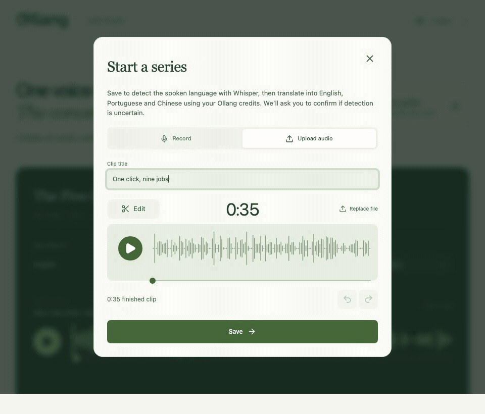
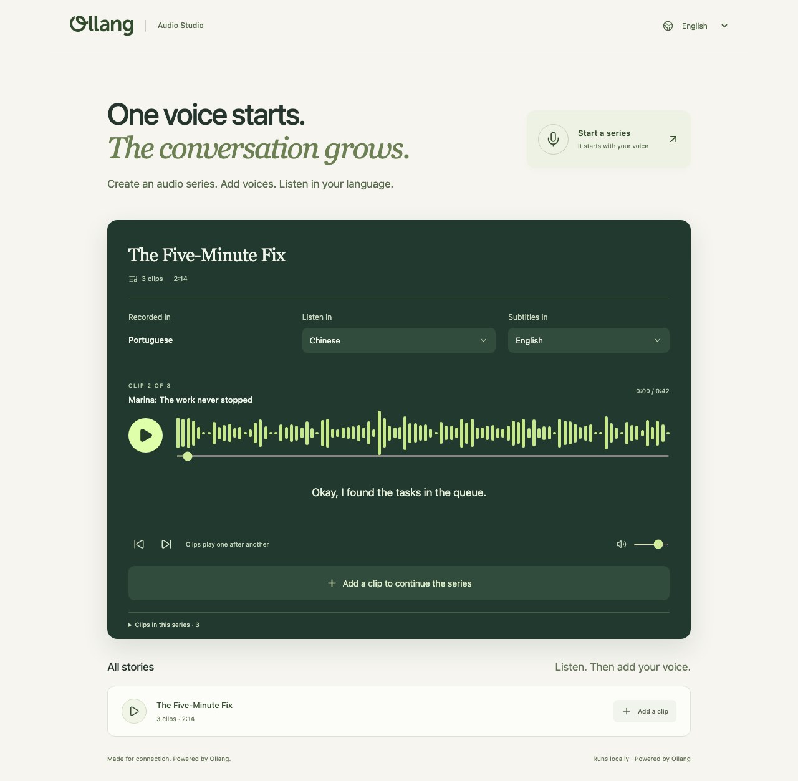

# Ollang Audio Studio

<picture>
  <source media="(prefers-color-scheme: dark)" srcset="public/brand/ollang-logo-on-dark.svg" />
  
</picture>

**Different voices. One conversation. Listen in your language.**

An audio series can begin in English, continue in Portuguese, and pick up in
Chinese. With Ollang, a listener can follow every clip in one language, hear the
original recordings, and choose subtitles independently. The interface is
localized too.

This runnable reference app shows both sides of localization: **audio translated
through Ollang at runtime**, and **interface strings translated through Ollang
during development**.

[Run locally](#run-locally) · [Get an API key](https://developers.ollang.com) ·
[Trace the integration](docs/integration.md) · [Install with an agent](docs/agent-runbook.md)

**English · Português · 中文** — three original languages, one continuous series.



Save a clip, follow detection and translation progress, then switch audio and
subtitle languages independently. This silent workflow preview uses simulated
processing and prerecorded Ollang results; it does not show actual turnaround
times. Run locally to hear the audio and translate your own recording.

<details>
<summary>See the full studio</summary>



</details>

## Run locally

### Prerequisites

1. Install Docker with Compose v2 or newer and start the Docker engine.
2. Clone the repository and open its root directory:

   ```sh
   git clone https://github.com/ollang/ollang-audio-studio.git
   cd ollang-audio-studio
   ```

   You can also download the source ZIP from GitHub and open the extracted directory.

3. Create a **free developer account** at
   [developers.ollang.com](https://developers.ollang.com) and obtain your API key.
   Translation uses Ollang credits; account signup does not promise a processing allowance.
4. In the repository root, copy `.env.example` to a new file named **`.env`**.
   Do this only if `.env` does not already exist. On macOS/Linux:

   ```sh
   cp .env.example .env
   chmod 600 .env
   ```

   For Windows, see [the PowerShell instructions](docs/getting-started.md#first-start).

5. Open **`.env` in your editor** and put your key after `OLLANG_API_KEY=`:

   ```dotenv
   OLLANG_API_KEY=your-api-key
   ```

   Replace `your-api-key` with your actual key and save the file.
   Edit `.env`, **not `.env.example`**.
   `.env` is ignored by Git; never commit it or paste its contents into chat.

For the full recording-to-translation workflow, finish the `.env` setup before
starting the app. **Just exploring?** You can skip signup/key setup and use the
bundled example, recorder/editor, uploads, and local detection without a key.

### Let an agent set it up

Open the checkout in your coding agent and paste:

```text
Read AGENTS.md and docs/getting-started.md. Get this app running locally with
Docker Compose. Preserve existing configuration, recordings and volumes.

Preserve my existing .env and verify key presence without displaying values.
Create .env from .env.example only if absent. If my key is missing, give me the
absolute .env path, link https://developers.ollang.com, and ask me to add the key
locally. Wait for my confirmation. Do not ask again if it is already configured.
Never ask me to paste the key into chat or print its value. If I choose key-free
preview, continue without a key.

Follow docs/agent-runbook.md for safe presence/access checks and any existing
pending translation requests. Build/start the app, verify app and Whisper
readiness, and give me the local URL. Do not upload test audio or submit provider
orders; leave the app ready for me to record/upload and test translation myself.
```

The [full agent runbook](docs/agent-runbook.md#installation-prompt) includes the
installation details, a separately authorized live-test prompt, and review checks.

### Or set it up yourself

Once the prerequisites and `.env` setup above are complete, start the app:

```sh
docker compose up --build -d
```

Open **<http://localhost:4310>**. Docker includes Node, Python, FFmpeg, and Whisper;
you do not need to install them on your computer. The first start downloads a
pinned Whisper model. See [setup](docs/getting-started.md) for readiness and port settings.

The Five-Minute Fix is already bundled with three original clips in English,
Brazilian Portuguese, and Mandarin, plus prerecorded Ollang audio and subtitles.
Playing it or changing languages creates no translation orders. Compare a
listening language with **Original audio**; see the [listening guide](docs/demo.md).

## Translate your own recording

1. Choose **Start a series**, or **Add a clip to continue the series**. Record or
   upload a short clip, optionally edit it, then **Save**.
2. Watch **Whisper detect the source language**. Confirm the language if detection
   is uncertain. Ollang translation then starts automatically into the other
   supported languages: **English, Portuguese, and Chinese**.
3. Follow progress in the player, expand **Behind the translation** for job
   activity, then choose a delivered listening language and subtitles.

With a key configured, **Save requests automatic translation and uses Ollang
credits**. Clips saved without a key retain that request and may start when a key
is configured later. Older manual-mode recordings keep a **Translate audio**
button. If you skipped key setup, follow [Connect Ollang](docs/ollang.md) before
your first live test; review pending requests before enabling an existing library.

The editor supports trimming, removing a section, volume changes, fades,
additional takes, undo, and redo. Saved clips can be up to two minutes. For a
first provider test, **3–5 seconds of clear speech** is enough.

## Learn from the code

The integration is **upload → create order → poll → collect audio and captions**.
Start with the [walkthrough](docs/integration.md), then explore:

| File                                               | Responsibility                                                        |
| -------------------------------------------------- | --------------------------------------------------------------------- |
| [Provider adapter](server/provider.ts)             | Ollang authentication, uploads, orders, status, and app-string export |
| [Translation worker](server/translation-worker.ts) | Persistent jobs, polling, collection, and safe recovery               |
| [Translation storage](server/translation-store.ts) | Local source/job receipts and duplicate prevention                    |
| [Playback policy](src/playback.ts)                 | Original/translated audio choice and caption timelines                |
| [App localization](docs/localization.md)           | Stable keys, i18next, and Ollang-generated catalogs                   |

React/Vite runs in the browser. A small Node/TypeScript API stores clips and
receipts in SQLite; media stays in local files. Python runs CPU language detection.
This is a single-user local example with no login or cloud-storage setup. See
[architecture](docs/architecture.md) before adapting it for another environment.

## Develop and test

With Node 22.17+ installed:

```sh
npm ci
npm run check
npm test
npm run build
npx playwright install chromium
npm run test:e2e
```

Tests use temporary databases and local provider doubles. They need no Ollang key
and do not submit real orders. See [development](docs/development.md) for Vite/API
startup and [testing](docs/testing.md) for browser, audio-service, and Docker checks.

For an agent, copy the [installation prompt](docs/agent-runbook.md#installation-prompt).
It includes the signup link, private key placement, user confirmation, readiness
checks, and a separate opt-in live test.

## Guides and contributions

- [Install, configure, and keep your data](docs/getting-started.md) · [Use the studio](docs/usage.md)
- [Ollang account and API setup](docs/ollang.md) · [Configuration reference](docs/configuration.md)
- [Troubleshooting](docs/troubleshooting.md) · [Job recovery](docs/provider-recovery.md)
- [Local API](docs/api.md) · [Local CLI examples](examples/README.md)
- [Contributing](CONTRIBUTING.md) · [Security](SECURITY.md) · [Dependency and media notices](THIRD_PARTY_NOTICES.md)
- [Dependency updates and vulnerability checks](docs/dependency-maintenance.md)

Stop with `docker compose stop`; resume with `docker compose start`. Keep the
volumes to retain recordings, collected translations, receipts, and model weights.

Source and documentation: [MIT](LICENSE), copyright 2026 Ollang Inc.
Bundled audio, captions, test media, screenshots, and branding have separate
[media permissions](MEDIA_NOTICE.md). See the [maintainer checklist](docs/maintainer-checklist.md)
for the remaining publication steps.
